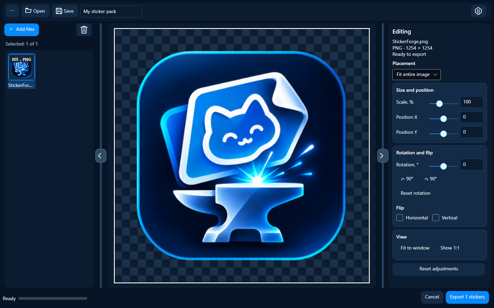
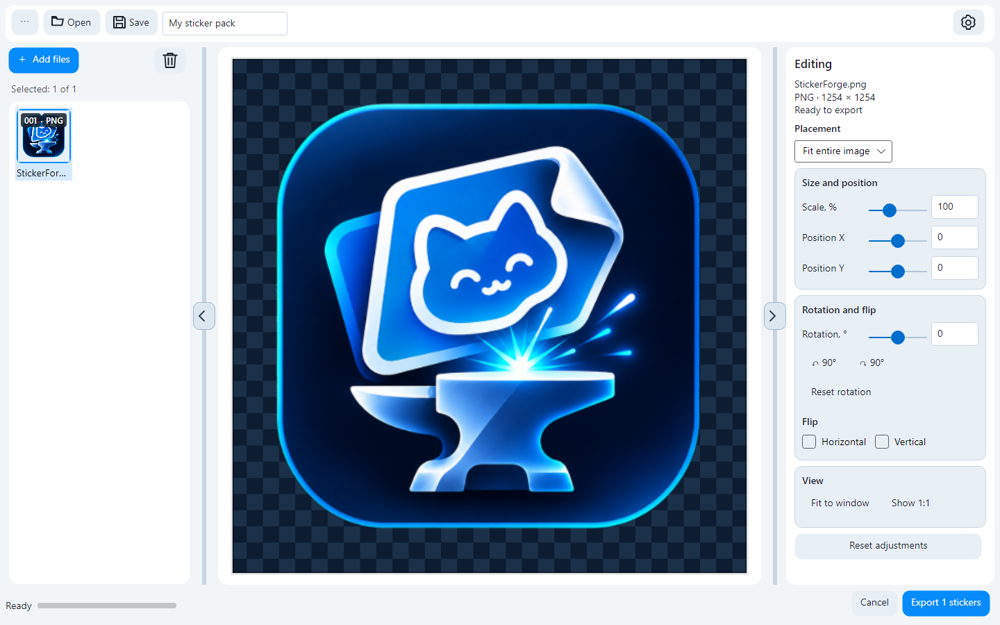

<p align="center"></p>

<h1 align="center">StickerForge Studio</h1>
<p align="center"><strong>Create Telegram stickers. Simply.</strong></p>
<p align="center">English · <a href="README.ru.md">Русский</a></p>
<p align="center">
  <a href="https://github.com/alekator/Telegram-Sticker-Studio/actions/workflows/ci.yml"></a>
  
  
</p>

## Overview

**StickerForge Studio — Create Telegram stickers. Simply.**

A free, offline desktop application for turning images, GIFs, and videos into Telegram-ready stickers. Import your media, adjust your stickers, preview the results, and export an entire sticker pack in just a few clicks.

## Features

- Free to use, fully offline, with no accounts, registration, ads, or subscriptions.
- Import files or folders in batches, reorder the gallery, and apply settings to a selection.
- Fit, fill, stretch, or manually adjust each sticker; scale, move, rotate, and flip it.
- Preview changes as you work and choose an animation segment of up to three seconds.
- Export static WebP and VP9 WebM video stickers, with automatic Telegram format validation.
- Save projects with their sticker order and individual adjustments. Source files are not modified.
- Choose English or Russian, and a dark, light, or system theme.

Export is local: StickerForge does not sign in to Telegram or publish packs. Upload the finished files to Telegram yourself.

## Screenshots

Captured from the current application in English using the included logo as sample media.

<details open><summary>Dark theme</summary>



</details>

<details><summary>Light theme</summary>



</details>

## Download

### [Download StickerForge Studio v1.0.0 for Windows x64](https://github.com/alekator/Telegram-Sticker-Studio/releases/download/v1.0.0/StickerForge-Studio-v1.0.0-Windows-x64.zip)

Extract the ZIP, then open the `StickerForge-Studio` folder. Development builds are also available from [GitHub Actions](https://github.com/alekator/Telegram-Sticker-Studio/actions/workflows/windows-package.yml).

## Getting Started

1. Download and extract the complete ZIP. Keep the files and `tools` folder together.
2. Double-click `StickerForge.Desktop.exe`. The Windows package includes the .NET runtime, FFmpeg, and FFprobe; no installation or PATH configuration is required.
3. Choose **Add files** or drag media into the window. Select a sticker and adjust its placement, scale, position, rotation, and flip.
4. For animation or video, select the desired fragment. Preview the result and use **Save** if you want to reopen the project later.
5. Choose **Export stickers** and a destination folder. The app checks the resulting files and reports any errors.

## Supported Formats

| Input | Export |
| --- | --- |
| PNG, JPEG, static WebP, BMP, TIFF | Static WebP |
| GIF, APNG, animated WebP, MP4, MOV, MKV, WebM, AVI | VP9 WebM video sticker |

Supported codecs inside video containers depend on the bundled FFmpeg build. Output uses a transparent 512 × 512 canvas. Static WebP is limited to 512 KiB; video WebM is silent, at most three seconds and 256 KiB. If a file cannot fit the constraints, export reports an error instead of producing an invalid pack.

Animation preview for GIF and animated WebP can use a fallback path that differs from video export; inspect the exported result when exact frame-by-frame matching matters. The entire pack is staged and the final folder is created only after all files pass validation.

## System Requirements

- Windows x64. The packaged build has been exercised on Windows; Windows 10/11 compatibility depends on the supported versions of [.NET](https://learn.microsoft.com/en-us/dotnet/core/install/windows) and [Avalonia](https://docs.avaloniaui.net/docs/supported-platforms).
- Disk space for the extracted application, source media, and exported stickers.
- No separately installed .NET runtime, SDK, FFmpeg, or FFprobe is required for the packaged build.

## Build from Source

Install the .NET 10 SDK (the Windows packaging workflow uses 10.0.110) and restore packages from NuGet:

```sh
dotnet restore StickerForge.sln
dotnet build StickerForge.sln -c Release --no-restore
dotnet test StickerForge.sln -c Release --no-build --no-restore
dotnet run --project src/StickerForge.Desktop/StickerForge.Desktop.csproj -c Release
```

Video import and export from a source build require FFmpeg and FFprobe. The Windows packaging workflow retrieves a pinned archive and checks its SHA-256 before publishing a self-contained app. See [distribution notes](docs/WINDOWS-DISTRIBUTION.md) and [the packaging script](eng/package-windows.ps1).

## Technology Stack

- C# and .NET 10
- Avalonia UI and Fluent theme
- SkiaSharp for image decoding and rendering
- FFmpeg and FFprobe for video and animation processing
- xUnit and GitHub Actions for automated checks

## License & Third-Party Components

The app includes FFmpeg and other third-party components; their notices are in the archive's `licenses` folder and the [Windows distribution notes](docs/WINDOWS-DISTRIBUTION.md). The complete inventory and relinking materials for the static FFmpeg build have not yet been verified. No source-code license for StickerForge Studio has been specified in this repository.
