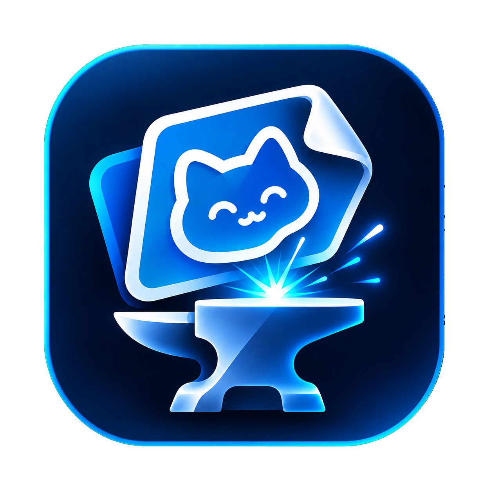
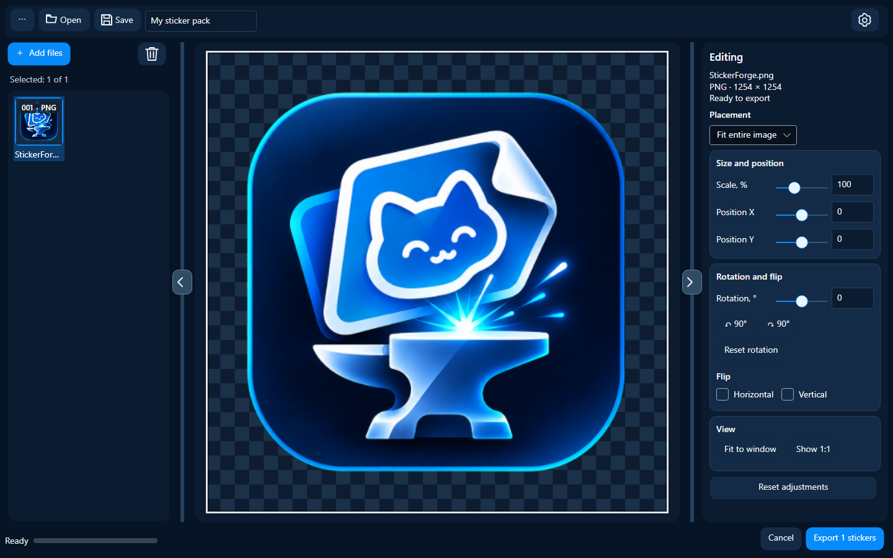
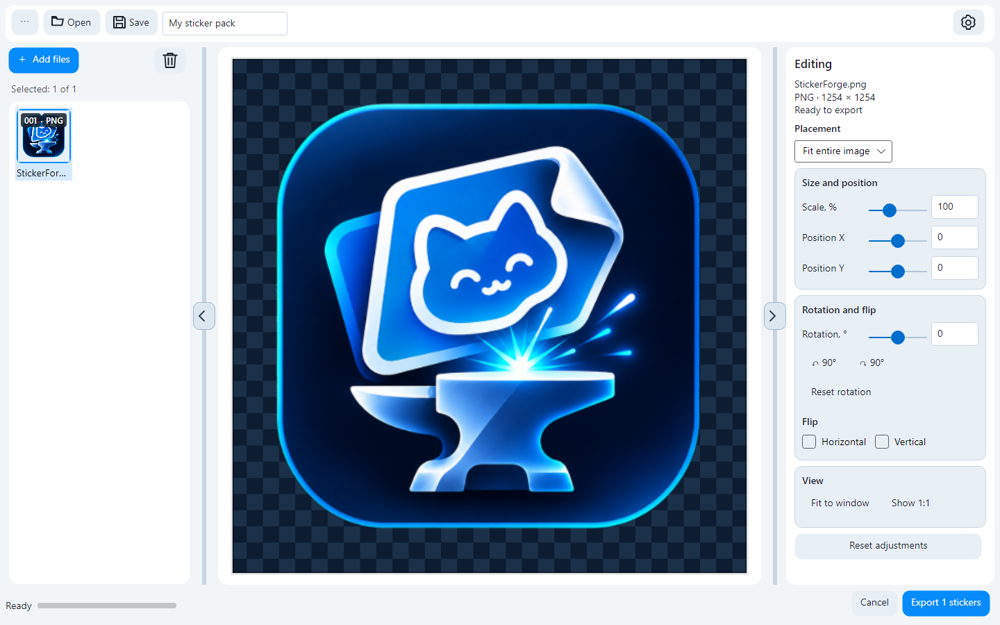

<p align="center"></p>

<h1 align="center">StickerForge Studio</h1>
<p align="center"><strong>Создавайте стикеры Telegram. Просто.</strong></p>
<p align="center"><a href="README.md">English</a> · Русский</p>

Бесплатное приложение для локальной подготовки изображений, GIF и видео к экспорту стикеров Telegram. Без аккаунта, регистрации, рекламы и подписки.

## Возможности

- Пакетный импорт файлов и папок, сортировка галереи и групповая настройка.
- Подгонка, масштаб, перемещение, поворот и отражение; предпросмотр результата.
- Выбор фрагмента анимации до трёх секунд.
- Экспорт статических стикеров в WebP, анимации и видео — в WebM VP9 с проверкой ограничений Telegram.
- Сохранение проекта, порядка и индивидуальных настроек. Оригиналы не изменяются.
- Русский и английский интерфейс; светлая, тёмная и системная темы.

## Скриншоты





## Скачать и запустить

[Скачать StickerForge Studio v1.0.0 для Windows x64](https://github.com/alekator/Telegram-Sticker-Studio/releases/download/v1.0.0/StickerForge-Studio-v1.0.0-Windows-x64.zip). Промежуточные сборки доступны в [GitHub Actions](https://github.com/alekator/Telegram-Sticker-Studio/actions/workflows/windows-package.yml).

Распакуйте ZIP целиком, откройте папку `StickerForge-Studio` и запустите `StickerForge.Desktop.exe`. В состав входят .NET, FFmpeg и FFprobe; устанавливать их отдельно и настраивать PATH не нужно.

Полный инвентарь лицензий и материалы для перелинковки статической сборки FFmpeg ещё не подтверждены; подробности — в [описании поставки](docs/WINDOWS-DISTRIBUTION.md).

## Использование и форматы

Импортируйте PNG, JPEG, WebP, BMP, TIFF, GIF, APNG или видео MP4, MOV, MKV, WebM, AVI. Доступность кодеков зависит от поставляемого FFmpeg. Выберите файл, настройте его на холсте, для анимации задайте фрагмент и нажмите **Экспортировать стикеры**. Готовые файлы загружаются в Telegram вручную.

Статические изображения сохраняются как WebP до 512 КиБ; анимации и видео — как WebM VP9 без звука, до трёх секунд и 256 КиБ. Результат размещается на прозрачном холсте 512 × 512. Итоговая папка создаётся после успешной проверки всего набора. Резервный предпросмотр GIF и анимированного WebP может отличаться от экспорта — проверяйте готовый файл, если важно точное совпадение кадров.

## Сборка из исходников

Для разработки нужен .NET 10 SDK и доступ к NuGet при восстановлении зависимостей:

```sh
dotnet restore StickerForge.sln
dotnet build StickerForge.sln -c Release --no-restore
dotnet test StickerForge.sln -c Release --no-build --no-restore
dotnet run --project src/StickerForge.Desktop/StickerForge.Desktop.csproj -c Release
```

Для видео при запуске из исходников нужны FFmpeg и FFprobe. Стек приложения: C#, .NET, Avalonia UI, SkiaSharp, FFmpeg и xUnit.

## Лицензии

Лицензия исходного кода самого StickerForge Studio в репозитории не указана. Сторонние компоненты распространяются на собственных условиях; см. [уведомления о Windows-пакете](docs/WINDOWS-DISTRIBUTION.md) и [сведения о зависимостях](docs/LICENSING.md).
